# Local agent integration

The current implementation integrates the local OpenCode v2.2.0 CLI and Codex. The OpenCode protocol follows the local `opencode run --help`; official documentation is at [CLI](https://opencode.ai/docs/cli/). No resident HTTP service is required.

## Execution path

```mermaid
flowchart LR
  UI[Run goal / Add to queue] --> Snapshot[Read research stage / model / instructions / working directory]
  Snapshot --> Save[Persist run snapshot first]
  Save --> Worker[Dedicated worker thread]
  Worker --> CLI[OpenCode standalone run]
  CLI --> JSON[JSON events + stderr]
  JSON --> Queue[Bounded event queue]
  Queue --> GPUI[Consume events every 80ms / live log]
  GPUI --> Disk[Coalesced save / flush immediately on finish]
```



The actual invocation is equivalent to:

```text
opencode --standalone run --format json --model provider/model --agent build --title "task / stage" -- "full request"
```

The Rust `Command` passes each argument separately and does not go through a shell. The working directory and `PWD` are both set to the canonicalized project directory; the request also contains that directory. Each invocation uses its own session, with no implicit `--continue`. The next stage hands off context through project files and the task description, and does not automatically splice the entire history log into the prompt.

Model discovery calls `--version` and `models --standalone`, runs on a background thread, and has a 30-second timeout. The selection list supports filtering, and a custom model identifier can still be entered manually. Different projects may have different OpenCode configurations; select the corresponding project before refreshing.

## States and lifecycle

`AgentRun` stores the run ID, task ID/title, stage, agent, model, prompt, directory, start/end time, session ID, exit code, and log. Updating the research model configuration does not change historical snapshots.

Run states include Running, Cancelling, Succeeded, Failed, Cancelled, Interrupted, Blocked and Stale. A non-zero CLI exit, a top-level error event, or a stream read failure is recorded as Failed. A single failure inside a tool does not necessarily mean the entire Agent failed, because the Agent may recover by itself.

Unix child processes are started in a dedicated process group. Cancellation immediately notifies that group, and the worker reaps the main process; on normal completion, descendants still holding the pipes are cleaned up, and stream read-out has an upper time limit. Quitting the app waits for the worker to reap; log/Session/Finished events that the app has not yet consumed are still written back to the record. A hard kill of the app provides no guarantee of background job recovery.

The run snapshot must be savable before actual execution. While a run is in progress, undoing and archiving that task are prohibited; when undoing other in-memory edits, run history and monotonic task IDs are preserved, and file operations are not rolled back. The queue advances serially per Topic, with at most 3 concurrently running tasks within the current Topic that have independent resources and ready dependencies.

## Topic execution queue

`TodoBatch` supports continuing to append approved goals while running or paused, grouped by the order of each Topic's first submission. The next Topic is dispatched only after all goals in the same Topic have finished; within a group, tasks may run concurrently by dependency (at most 3), while sharing a session/directory/browser still remains mutually exclusive. Failed steps first go through automatic retry, and after exhaustion they are recorded in failed_tasks/failed_items; other runnable branches in the current Topic continue to the next Topic after they finish. Resubmitting a failed Topic appends it to the tail of the queue and does not affect completed results. Pausing does not reactivate historical failed items; stopping clears the entire queue, and closing the app still does not automatically resume execution.

`--qa-topic-queue` uses a temporary database and a local fake CLI to verify full-capacity appends, multiple Goals in the same Topic, deduplication, ordering, retry exhaustion, subsequent advancement, and pause/stop.

## Storage

### Automatic retry on task failure

After task execution or result validation yields `Failed`, the task is queued using the original input snapshot and session and waits 30 seconds before another attempt. Each user-initiated execution chain allows at most 3 automatic retries (4 attempts including the first); the count and the wait deadline are saved in the run record. The retry queue reuses the concurrency limit, shared-resource mutual exclusion, pre-dispatch approval, and input freshness validation; waiting does not occupy an execution slot. Batch execution transfers the original run association to the retry, continues advancing on success, and handles exhaustion as a failure.

Active cancellation, archiving, `Blocked`, `Interrupted`, and `Stale` are not automatically retried; project/request planning keeps its existing one-shot format-repair logic and does not layer task retries on top of it. Pausing a batch pauses retry dispatch; Stop task/Stop all can cancel the waiting; quitting the app marks queued work as interrupted, and a restart does not execute automatically. A new manual start by the user opens a new retry allowance. The interface shows a countdown, Retry N/3, and an exhaustion notice.

`Storage` uses `{ "version": 3, "workspace": ... }` (versions 1/2 are readable and are migrated on save; older binaries reject version 3 in order to preserve the manual admission constraint) JSON. New fields use serde defaults; unknown versions and corrupted content are explicitly rejected. Saving uses a same-directory temporary file, flush/fsync, and rename; an exclusive lock on the same-directory `workspace.lock` is held until the app exits.

All Store modifications that are surfaced by UI notifications are saved by a unified observer. Execution logs are coalesced at about 500 ms, and are force-saved on exit and on terminal states. On load, leftover Running/Cancelling are marked Interrupted, received output is preserved, and nothing is re-executed.

## Research execution path

`ResearchTask.kind` has Goal / Collect / Analyze / Advise; `ResearchConfig.models` stores the model for each of the four roles separately. The StagePolicy of old workspaces is retained only for reading and saving historical data. A Goal run has the model return a JSON plan, validating count, title/instruction length, forward dependencies, and required roles; child tasks are created only if everything is valid, and an existing plan is not overwritten. Research child tasks retain a fixed goal ownership.

Downstream requests include the parent goal, the current task description/comments, the verified body text and structured sources of direct dependencies, and the current and parent attachments. Freshness is validated recursively via the input signature and dependency run IDs; the signature does not include activity and task state produced by execution. If inputs change during a run, the result is Stale; the exit path runs the same validation and never auto-resumes.

The run result body comes from OpenCode text events (the last complete text part is kept; earlier explanations remain in the log). Research non-planning roles must return `{status, report, sources}`, with status being complete or blocked; a step is marked Done only when the report parses successfully. The Browser path of `ResearchConfig` is added to the request only in the Collect role; OpenCode reads the local skill and then controls an independent Space. By default, OpenCode's global permissions are not modified and --auto is not added; being blocked by permissions should be explicitly reported as blocked.

`Run remaining` calls the same next-ready-task logic after each terminal state is saved. It stops on failure, blocked, stale, cancellation, save failure, or when there is no runnable dependency. Consecutive intent lives only in memory and does not continue after a restart. Each new task fetches the latest material anew, while already-run requests keep their snapshot.

## Optional Longbridge MCP queries

Prompts for the collection, analysis, and reporting stages include Longbridge MCP discovery guidance; pure planning stages do not query. When stock, company, quote, valuation, or industry information is needed, OpenCode inspects the services and tools exposed in the current session; if necessary, it runs `opencode mcp list` in the run directory to confirm configuration and connection status, then selects read-only public-information queries based on the actual tool descriptions and parameters. Reuse sufficient existing evidence; do not fix tool names or assume market coverage.

Reuse OpenCode's own MCP configuration; do not install services, modify credentials, or change permissions. When a service is unavailable or a tool is unsuitable, fall back to the browser and existing materials; block the research only when all available sources still cannot provide the necessary evidence. The prompts prohibit account, position, order, trading, funds, and other write operations; this is an agent behavior constraint, and actual tool permissions are still determined by the OpenCode/MCP service configuration.

The report records the tools actually queried, non-sensitive parameters, symbol/market, observation and retrieval time, currency/units, and data limitations, and passes these downstream. When a tool does not return a link, note the query source in the body text and do not fabricate a URL. The existing web-source contract is unchanged: completing collection still requires at least one actually visited, verifiable web source; MCP is used as supplementary evidence.

## File and browser boundaries

Attachments are copied into the data directory `attachments/`, using unique filenames, create_new, and Unix 0600. The default directory is 0700; type checking uses extension and magic, which is not equivalent to full document decoding. Path resolution is restricted to managed directories, rejecting escapes and directory symlinks. Removing a reference does not delete the physical file, and run snapshots/undo will not reference files that have been automatically cleaned up.

The attachment path passes originals directly: when adding, only the original file is copied; at run time, OpenCode uses `--file`, while Codex receives images through `--image` and other files as local paths in the prompt. No local OCR or text extraction is performed. Materials from the parent goal and from dependency tasks are all passed downstream, and complete reports are required to cite each material name; when a material cannot be read, blocked must be reported.

On 2026-10-28, real read-only research acceptance was completed: the installed skill guide was read, actual navigation and saving of page screenshots and PDFs happened within the same ego Space, collection → analysis → briefing ran automatically, models were switched across stages, results and sources were passed along, and persistence recovery was verified. The final Space finished normally. The real model produced output in the form "explanatory text + a single JSON code block"; the parser now accepts this wrapper but still strictly validates the JSON, status, and sources; multiple blocks or incomplete output are still rejected. The first parse-failure record is retained, and the retry did not repeat collection. Real takeover scenarios have not yet been verified separately; the local PDF/OCR verification at that time belonged to a historical path; it has now been changed to passing raw attachments. Browser source examples change with versions; at run time, `ego-browser skill` is authoritative. Official references: [ego-browser](https://lite.ego.app/document/en/docs/ego-browser), [current Skill](https://github.com/citrolabs/ego-lite/blob/main/skills/ego-browser/SKILL.md).

## Project candidate topic planning

`project_planning.rs` separately defines the project planning contract `{tasks:[{title,brief}]}`, kept separate from the research stage plan `{title,instructions,kind,depends_on}`. The project name, optional scope, directory, and existing-topic snapshot form the input signature. The return value is first fully validated for count/length/duplicates, and only then is a research Goal with `requires_approval=true` created in Backlog. The planning prompt only requires topic decomposition and does not require networking or research; the local OpenCode permission boundary stays as it is.

Project runs use `AgentRun.project_plan=Some(project_id)`; `task_id` is 0 in this case and is not used as a real task. Both kinds of runs reuse `launch_run`, Request/Event, logging, cancellation, abnormal-exit recovery, and pre-launch saving. Project run history jumps to the project board and does not look up fictitious tasks.

`requires_approval` is used only for parent Goals generated by projects. Backlog means pending approval; entering Todo means approved; unapproved/cancelled topics cannot jump directly to the execution or completion state. Child tasks inherit the admission constraint via goal_id; request preparation, plan application, next-task selection, and result input signatures all check the parent goal. After returning to Backlog, the current external process is not cancelled immediately, but results completed during that window become invalid and the subsequent chain stops. No new scheduler or model invocation on state change was introduced.

Candidate topics copy the project scope at creation time, preventing subsequent modifications to the project description from implicitly changing approved tasks. A successful plan is not applied twice and preserves user edits; if project inputs change during a run, the run is Stale, and failures or cancellations do not produce cards.


## OpenCode / Codex mixed-stage execution

The global default and the four research stages on the settings page each store an Agent + model combination. Legacy configurations default to OpenCode; stages can override the Agent and model, and Use global clears both at once. An empty model for a different Agent does not inherit another Agent's model; when the global Agent is switched, existing stage models are pinned to the original Agent. Queued and historical runs keep the Agent/model snapshot from creation time.

Codex runs via the local `codex exec --json --model`, reusing the CLI login and MCP configuration. The model list comes from the models_cache.json local to the current CODEX_HOME and shows only visible models; it does not represent live account quota; when there is no cache, a model ID can be entered manually. Discovery only runs version and login-status checks and does not send inference requests. Codex uses a workspace-write sandbox, allows network access, and disallows interactive approval; when permissions are insufficient it should return blocked and not enable full-permission mode.

Each task has its own session; only a failed attempt with the same task, Agent, and model that is recoverable continues the original session. OpenCode and Codex hand off through evidence, sources, and dependency files saved by the app, and do not share sessions. Codex events enter the unified run log, and the final content is read from a private temporary --output-last-message file, avoiding progress text polluting the JSON contract. Images are passed via --image, and other attachments are passed as local file paths as evidence; when they cannot be read, blocked is reported explicitly.

An active Codex task can cancel its process group. After an abnormal exit, the attempt lease inherited by the child process determines whether it is still running; after stopping, the saved Codex session can be explicitly resumed; Codex private rollout files are not parsed to import unsaved results. A Codex left running by an old instance cannot be stopped via the OpenCode interrupt API, and the interface reports that its completion must be waited for. None of the recoveries re-run automatically.
