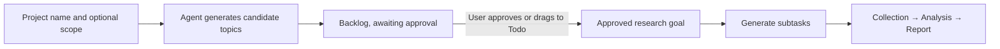
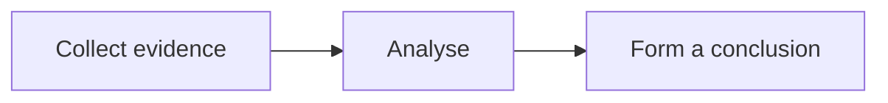

# What the hell are you planning? User guide

This tool breaks a research goal into tasks that depend on one another. It uses a local OpenCode or Codex agent, choosing the agent and model for each stage, and keeps run logs, materials, reports and sources. You can also turn repeated information checks into scheduled automations. Web research is carried out by the local ego(lite) Space.

Everyday flow: **choose a project → review topics and move them into Todo → Run Todo → read the results in Research results**. Recurring tasks go through **Automations → New automation**, and you check each period's results in **Automation results**. When you need more evidence, open the task, add PDFs, screenshots or comments, and then continue the research.

The task page puts running, materials, status and results first. A finished research step opens its result with **View final report** or **View latest result** in the task action row, and **Run again** runs it once more. **More details…** keeps the model, working folder, Cycle, Bucket, parent task and tags. **Research settings…** at the top right of the research page opens Settings on the model and agent configuration, and does not clear a goal you have typed but not yet submitted.

## 1. First launch and the interface

On launch you first confirm the workspace, then check the AI agents and ego(lite).

The AI agent check runs separately against OpenCode and Codex using `--version`. **Only one of them needs to work to pass**; you do not have to install both, and the app only stops you when neither is available. ego(lite) still needs to read the full guide for the local `ego-browser skill` and complete its first-time setup. You can change the path for each tool and then click **Check again**. If you change the path of an agent that was passing, that check fails; another agent that is already verified and whose path has not changed can still satisfy the requirement. **Continue** becomes available once the workspace, at least one agent and ego(lite) are ready. The launch checks do not call a model, do not check subscription limits and do not switch your saved stage settings; once you are in the app, choose the agent and model you actually want in Settings.


Run `cargo run`, or open the built `target/debug/what-the-hell-are-you-planning`. The currently verified environment is Apple Silicon macOS, and it needs at least one configured OpenCode or Codex.

A new workspace has a single default project, **Workspace**, with no demo tasks, preset models or simulated runs. An existing workspace restores your real tasks and history. The workspace row at the bottom of the sidebar opens **Reveal data folder**, **Copy data folder path** and **Settings…**; the theme icon beside it cycles through **System / Light / Dark**, and the choice is saved automatically.

Clicking a finished Goal in the sidebar shows its current final report directly, and a finished Task shows its own result. **View original goal / View original task** shows the original task information. If a task is unfinished, failed, blocked, running or has an outdated result, its details still open; a task you completed by hand without a result also stays on its details page. Archiving a completed Goal keeps its completed step count and results available as read-only history; **Restore** returns its prior lifecycle without requiring a new approval.

When the app starts, the sidebar expands only the Project you used last and shows its Topic list; other projects, and the tasks and sub-steps inside a Topic, are collapsed by default. Click the arrow to expand them yourself, and opening a specific task expands the levels it sits in. On first use, or if the last project has been deleted, every project is collapsed by default.

| Area | What it is for |
| --- | --- |
| All research / Projects | Browse research goals and tasks, filter by status, switch between list and board, start new research, edit, archive |
| Settings (workspace menu at the bottom of the sidebar) | Set the global Agent/model, overrides for the four research stages, concurrency and report publishing |
| Market research (opened from **New research**) | Propose a research goal and see existing research; advanced configuration opens only when you need it |
| Settings → Agent & models | See and change the Agent and model actually used globally and by each stage |
| Research results | Follow research progress, reports and sources; technical details show the model and logs |
| Automations | A separate automation area: All automations manages the definitions, Automation results shows each period's results |
| Archive | View and restore archived research; completed Goals keep their retained results and completion count |

Actions are grouped by purpose: the page's main advancing action uses the filled primary button, supporting actions use bordered secondary buttons or icon controls, and lower-frequency project options such as **Rename project…** and **Working folder…** live in the ⋯ menu. On a project page, **New research** is the primary action and **Run / resume** is a secondary queue action; native light/dark and compact-layout validation of that hierarchy remains pending. List / Board is a segmented switch, and display options are tucked into the sliders icon. Selection controls are visually separate from advancing actions. Form controls keep their borders, while statuses and tags are shown as information only. Icon buttons have hover tooltips, keyboard focus and accessible names. The maintained route and action contract is in [Route and action matrix](doc/ROUTE_ACTION_MATRIX.md).

**All** includes every task that is not archived by default. The status dropdown to the left of the search box offers **All statuses / Open / Backlog / Todo / In progress / In review / Done / Cancelled**; Open leaves out Done and Cancelled. The status filter and search work together, and archived tasks stay in Archive. Show completed is no longer used in All, while other views such as a project still offer this display option.

The global list groups tasks by project, and clicking a group heading takes you into that project; the fixed **← Back** at the top returns to the parent shown in the location path. Cards on the global board show the project name. A project's own list is still organized by parent task and sub-steps.

At the top of **Research results**, choose a project first. The research goal title is the way into the details: click it to see the goal's scope, questions, sub-tasks and additional materials. When there are several goals, **Switch ▾** next to the title switches between them, and when there is only one goal no useless switch is shown. The middle only lists tasks in the current scope that have run records. Each entry shows the task number, type, latest status and full title, so goals and run records are no longer mixed together in a multi-level tree. **Planning activity** separately folds away planning records such as topic generation and goal breakdowns. The **Latest / Earlier version** dropdown on the right compares the past results of the same task, and switching versions does not change the task list. Opening a report shows the project and Goal it belongs to in the results context; it does not switch the sidebar page.

There is only one **← Back** in the whole app, at the top left (shortcut **⌘[**). It returns to the context that opened a detail when the app recorded one — for example a step opened from its period dialog, a report opened from a task, **Open steps** from a Goal card, or an entry chosen from Recently opened — including its recorded filter, layout, scroll and selected item where available. Otherwise it follows the structural parent shown in the location path. It is not a browser-style history: restoring the entire chain from a filtered results page through a period and a step is still target work under the navigation integration, so do not assume every page is restored. The shortcut does not trigger page navigation while a dialog is open.

If you leave a task edit, automation wizard or research request with unsaved input, the app offers **Save … and continue**, **Discard and continue** or **Stay** instead of silently losing the draft. A clean Cancel or Close leaves immediately.

The single-line location path next to Back shows where you are, for example **project / parent task / current task**, and on a report page it reads **Research results / project / research goal / current result**. Projects and parent tasks are clickable; after following the path you can still use Back to move up its parent chain. Task details no longer show a second back button. **Open tasks** only switches between tasks you already have open, and **Close current task** at the bottom of the menu closes the current task and takes you back; when planning finishes in the background it does not pull you away from another page you are reading.

**Sources · N** at the bottom of a report is collapsed by default; click it to show the source links and publication dates, and click again to collapse it. It collapses again when you switch tasks or run versions. Citations and links in the report body keep working.

Properties in task details such as Stage, Priority and Topic project use text dropdowns: the arrow means the value can be changed, and the status color and hover feedback help you tell them apart. Properties of running and archived tasks stay read-only.

**⋯ → Rename project…** at the top right of a project page opens an in-app rename dialog. After trimming leading and trailing spaces the name must be 1–160 characters long; cancelling changes nothing. Renaming only changes the display name: the Project ID, task numbers, working folder, Topic/task relationships and existing results stay the same. Valid plans that are running, queued or waiting to resume work with the new name straight away; plans that were already invalid do not become valid again. Old names in historical logs, prompts and reports are left as they were.

A project's List view groups Goals by Topic. Each group has its own heading and a count of the Goals matching the current filter, and clicking the heading takes you into the Topic. Topics that were moved in stay as separate groups; inside a group, newer content comes first, and after a search the headings of Topics with matching Goals are still shown.

Moving between projects works on whole Topics. Open the in-app move dialog from **Topic project → Move topic…** in the details, or from **⋯ → Move…** on a Topic. It first checks whether the move is allowed: if something blocks it, you see a scrollable list of reasons and suggestions for handling them; otherwise you get a searchable dropdown of target projects, excluding the current one and using project numbers to tell same-named projects apart. Pick a target and click **Move topic** to confirm; cancelling changes nothing. If there are no other projects, you are asked to create one first. Once confirmed, all Goals, sub-tasks (including archived ones), research requests and their connections under the Topic move together, while the Topic and task IDs stay the same. Existing valid results and approval status are kept, and outdated results do not become valid again; historical reports, attachments and run folders keep their old paths and no files are moved on disk.

The move confirmation dialog first lists every reason that blocks the move — task number, name, run status/run number, research request planning, plus Goals in the queue and sub-tasks waiting to run — along with a suggestion for each. When something blocks the move, only a close button is shown and the move cannot go ahead; when nothing blocks it, you get cancel and move buttons, and the checks run again after you confirm.

Run states that block a move are `Queued` (including waiting to retry), `Running`, `Recovering` and `Cancelling`, plus `Interrupted` runs that have not been replaced by a newer attempt. A batch queue that has not finished (including a paused queue) also blocks the move. A queued or running task can be stopped with **Stop task** in Progress, and you have to wait for the stop to finish. You can let the queue finish and then move, or use **Stop all**, which stops the whole batch and may affect other Topics. An interrupted task can be resumed from **Paused projects** and finished; you can also archive the Topic and confirm **Stop and archive** to give up the related runs, then restore the Topic later once the stop has finished. A normal task's board status, such as to-do, done or cancelled, does not by itself block a move. If a task depends across Topics, or a single research request is linked to several Topics, the move is refused and no data is partly changed. The task edit form no longer changes which project a task belongs to; use the Topic move entry points described above.

Use **Tab / Shift-Tab** to move between controls and **Enter / Space** to activate buttons; in a multi-line form, Tab moves to the next control. Focus stays inside a dialog while it is open. When `Generate topics` is greyed out, the text near the button explains that you need to set a folder, choose a model or wait for the current run.

**A research role is not the same as a task status**: Plan / News collection / Analysis / Investment brief decide which model does the research, while Todo / In progress / Done and so on describe the task's status. New runs start from a research goal or a research step.

## 2. Set up a real run end to end

1. Choose a project. The app has already assigned it a folder inside the workspace; to change it, use **⋯ next to the project title → Working folder…** and pick a folder inside the workspace. The agent reads and writes its output in that folder, but the app does not limit what it may do elsewhere on your system.
2. Open **Settings → Agent & models**, check the Agent's version, path and connection status, and click **Refresh local models** to update the model list.
3. On the same page, choose the global Agent and model; click the model field to expand it and search, and your change is saved automatically. Planning, collection, analysis and the final report share it by default.
4. Install ego(lite) and complete its first-time setup, enter the `ego-browser` path and click **Check runtime**. The usual path is `~/.local/bin/ego-browser`.
5. **Open browser** opens ego(lite). Each goal has its own Space name, which you can see in the browser's Space menu. When it runs, the app reads the operating guide that comes with the installed version.

Check runtime only confirms that the local guide can be read; whether web access actually works is something you judge from the logs and sources of the collection task. OpenCode / Codex use the sign-in and permissions already set up on your machine, and this app does not store API keys or approve interactive permission requests on your behalf.

### Global model and per-stage overrides

Global settings apply to every project in the workspace. You can pick a model your local Agent has configured or can use, or type the full `provider/model` (with optional `#variant`). For example, a model exposed by the configured provider `opencode-go` as `deepseek-v4.1-flash` is entered as `opencode-go/deepseek-v4.1-flash`; keep the configured provider prefix.

- For the four research stages, an empty model field inherits the global default; once you fill in a model, that stage's override is used first. The page shows where each model comes from and its full identifier.
- **Settings → Agent & models** shows the global configuration and all four stage overrides together. Click **Use global for all stages** to clear every stage override.
- For a single stage, click **Use global** to go back to the global Agent and model; the button is disabled when the stage already inherits them. All changes are saved automatically.
- Saving only affects runs started afterwards. Tasks already in progress keep the Agent and model they started with, and your history, research results and Todo approvals are kept; saving never starts a task by itself.

After saving, a **Saved** or **Not saved** message appears at the top of the page and you can dismiss it with ×. The global model, stage settings, research settings, task edits and folder changes all share this feedback; success means it was written to the local workspace, and a failed write keeps the reason. Saving again also shows the message again. Validation errors inside a dialog appear directly in the form, and saving a project's scope also shows a success message inside the dialog.

## 3. Generate candidate topics from a project and choose what to research

Create a project with **Projects → +** in the sidebar, for example "Semiconductor industry research". After creating it, **Plan project research** opens; on an empty project you can click **Plan topics**, and if the project already has tasks you open it through **⋯ → Plan research topics**.

1. You can optionally fill in the scope, market, time span and questions you care about. If you leave them empty, planning is based on the project name. Save the project scope with **Save scope**.
2. The project's working folder has already been assigned; set up the global Agent and model in **Settings → Agent & models**. If you want separate settings for planning, open **Research settings…** from the Market research page and choose the Plan override. Project topic planning and later research step planning share whatever configuration Plan is using.
3. Click **Generate topics** and the Agent produces 1–8 separate research topics, each with its own scope, evidence requirements and deliverables. You can follow the generation with live logs in **Research results**, or cancel it.
4. Planning then runs in the background. On success the app keeps your current page and reports how many research goals were added to **Backlog**, with a prompt to open the project to review and approve them. Every topic lands in **Backlog / Awaiting approval**, and no collection or analysis starts. Open a card to edit its scope or add comments, PDFs or screenshots.
5. Approve the topics you want by clicking **Approve research →** on a card or dragging it to **Todo**. The ones you leave stay in Backlog, and you can also move them to Cancelled or archive them. Without approval through Todo you cannot drag a topic straight to In progress / In review / Done to skip review.
6. Open an approved topic and click **Plan research steps**, and the Agent creates collection, analysis and report tasks for it, with their dependencies. Review them, then run them with **Run one step / Continue research**.



**Approving does not call a model right away.** The approval check also applies when a task runs, so unapproved topics and sub-tasks cannot run. Moving an approved parent topic back to Backlog stops anything further being scheduled; a step that is already running is not interrupted immediately, but results that arrive while it is withdrawn are marked Stale and continued running stops. Use **Stop task** if you need to stop a run right away. After you approve again, past results that still match the inputs can be reused.

Each project currently generates one batch of candidate topics; after it succeeds, **⋯ → Planning details** shows the scope. To make further changes, edit the existing cards rather than generating again, so your choices are not overwritten. You can retry after a failure, a cancellation, or a Stale result caused by changed inputs; an invalid result never creates topics partially. A topic keeps a snapshot of the project scope at the time it was generated, so later edits to the project description do not quietly rewrite approved tasks.

Candidate topics, approval state, project scope and planning runs are all saved automatically. A research goal does not run before it is approved.

### Propose a single research goal directly

If you already know the research question, you can still use the original entry point:

In **Market research**, fill in the goal title, background and scope. For example:

> Analyse supply, demand, pricing and investment opportunities for semiconductor memory — DRAM, NAND and HBM — for the rest of this year. Cover the main listed companies and separate reported figures from company guidance and market forecasts; list sources, catalysts, risks and data that is still missing.

Be clear about the research year, market, time range and key questions. Click **Create research goal** to open the parent task; you can add materials first, then click **Plan research steps**.

The real planning model produces 3–12 sub-tasks with dependencies between them. Check each task's scope and description, and edit it or add comments as needed. Dependencies follow the generated plan, and there is currently no visual tool for rewiring them; an existing plan is not regenerated over your tasks.

## 4. Running and checking

The Board shows the main stages as **Backlog → Todo → Execution → In review → Done**, and cancelled tasks stay in **Cancelled**. Inside the Execution lane, tasks are grouped by **Waiting → Queued → Running**, with the order, counts and category filters along the top; **Paused / Blocked** sit under **Needs attention**, and **Retrying** sits in Queued with its retry count and waiting time noted. Empty groups are collapsed, and filters only change what is shown, not the order things run in. The arrows show what comes before what; not every task has to pass through every status.

- **Ready**: the conditions are met but it has not been submitted yet, so it stays in Todo.
- **Waiting**: the results it depends on are not ready yet; steps of a submitted goal queue up automatically once their dependencies finish. Steps of an unsubmitted goal still belong to Todo.
- **Queued**: submitted, waiting for its turn in the Topic order, a retry time or a free execution slot.
- **Running**: there is a real run record. A goal is summarized across its whole task chain, so while one step is running the goal is not shown as Waiting just because its other steps are waiting.
- **Paused / Blocked**: the queue is paused, a run was stopped, or a failure needs handling; the card shows the reason and what to do next.

Dragging an approved research goal from Todo into Execution submits it and runs its research steps in dependency order. It stays on the Board after submission; if dependencies or resources are not ready it shows as waiting or queued, and it never pretends to be Running. Even when the current filter is Running, dragging still only submits the work. An invalid drop tells you why, and submitting again does not create a duplicate run.

You cannot drag from Backlog straight into Execution, drag a submitted or running task back to Todo, or mark a goal Done while skipping its research dependencies. Backlog → Todo only accepts and approves, it does not run; an unsubmitted Todo task can go back to Backlog. Pausing, continuing and stopping are done with queue or run actions. A research chain finishes automatically once every step has produced a valid result. Internal research steps are managed by the scheduler and cannot be dragged by hand to bypass overall approval or dependencies.

The Board, the List, the task tree on the left and the details on the right all show the same stage, status and reason for a task; the List shows status as text and supports filtering by main stage and by execution category, while the sidebar uses icons with hover explanations. Dragging by hand, the status menu and the edit form all follow the same rules about which changes are allowed. Runs finishing, retrying and resuming after an interruption are handled automatically and are not affected by the rules for manual changes. The results page still shows the status of the run you are looking at, so history is not overwritten by the current status.

The sidebar, List and Board share one newest-first ordering: projects and Topics by creation order, newest first, and tasks in the same group by creation time, newest first; when times are equal they go by task number, newest first, and tasks without a usable time go after those that have one, again newest first. A parent task still comes before its sub-tasks, the Execution lane keeps its status groups, and the same rules apply inside each group. Priority is shown only as a property and does not change the order. Display order does not change dependencies or the order in which a submitted queue runs.

### Running in a queue by Topic

1. On a Topic page, click **Queue topic** to add its approved, unfinished goals to the queue; you can also add just one goal with **Run goal / Add to queue** on that Goal's page. **Run / resume (N)** on a project page adds all approved goals in that project in one go, and changes to **Add to queue (N)** while it is running.
2. You can keep adding while something is running or all three execution slots are full, and submitting the same thing again does not create a duplicate queue entry. Approving or creating research does not add anything to the queue by itself; you have to click run or add to queue explicitly.
3. The queue moves through Topics in the order they were first added. Submitted goals in the same Topic finish their own collection, analysis and report together, and then the queue moves to the next Topic. Within that Topic, steps whose dependencies are met and which do not compete for the same resources run at the same time, up to the Research concurrency limit in Settings → General (3 by default). Topics that have not had their turn show as **Queued** and do not run early. Automation periods use their own queue and their own concurrency allowance, so they do not take Research slots and do not join this Topic queue.
4. When a step fails, it is retried automatically at 30-second intervals, up to 3 times. If retries run out, or you need to take over, or an approval is no longer valid, the failed or blocked status stays; once the other runnable steps in the current Topic have finished, the queue moves on to the next Topic automatically. When the queue ends you see how many goals succeeded and which ones need attention, and after fixing them you can add the failed goals back to the end of the queue.
5. **Pause after task** pauses further steps and retries while still letting you add to the queue; **Continue** carries on with Topics that have not been handled yet and does not re-run Topics that already failed; **Stop all** stops the tasks this queue has submitted and clears the waiting entries, keeping the results you already have. A failed save pauses the queue. If the next step cannot be submitted before a run record is even created — for example because the model settings or the context check failed — the current Topic is paused too, with the exact reason kept in the Goal's Activity; after fixing it, click Continue, and this is not treated as exhausted retries that should be skipped.

The status bar shows the current Topic, the order of what is queued next and how many goals failed. Unapproved Backlog items do not run; waiting goals that have been archived or had their approval withdrawn are skipped. Closing the app does not restore the queue or run tasks automatically, so you have to submit them explicitly again next time.

### A single research goal

- **Run one step**: runs the next unfinished or outdated task that can run.
- **Run goal / Add to queue**: adds the goal to the Topic queue, and when its turn comes it runs in dependency order. If retries run out, the results are kept and the queue moves on to later Topics.
- **Pause after this step**: pauses once the current stage is finished, without interrupting a run already in progress.
- **Stop task**: stops the current run immediately.

Research moves through one Topic at a time, with up to the Research concurrency limit running inside the current Topic. An explicit **Run one step** opens that run's progress page; queue actions keep you on the current page and report their state in the Topic queue bar. Background steps and scheduled automation periods do not change your route, selection, open dialog, scroll position or draft.

The progress page:

- By default it shows the current stage and anything that needs you; when finished it shows the report body, with the source list expanded on demand. An unfinished response during a run is never shown as a report.
- **Open task** stays at the top of the report, **⋯** on the right opens Technical details, and the copy icon next to the source count copies the report. Choose a project and research goal first, then look at the tasks in that scope.
- **⋯ (Technical details) → Live logs** shows steps, tool output and errors; logs have a length limit, and a marker appears when they are cut off.
- **Saved output** shows what was saved for this run; a successful piece of research shows the parsed body, while an attempt that failed validation keeps what the model returned. Click **Back to result** to return to the reading page.
- A run record keeps the model used at the time, the inputs, the materials, start and end times, the conversation it used and how it exited.

Each result entry says what it is: **Final report**, **Partial period reports**, **Intermediate evidence**, **Live progress**, **Planning attempt**, **Task result** or **No report**. A report can also carry an evidence-quality label such as **Complete**, **Evidence gaps**, **Needs input**, **Unverified legacy**, **Report rejected**, **Not validated** or **Incomplete**, together with freshness labels such as **Stale input**, **Regenerating**, **Original approved version**, **Historical result** or **Legacy result**. Streaming text is always **Live progress**, never a validated final answer, and a failed period can still show the step results that did finish.

Besides finishing successfully, a research result also has to pass a structure check; only `complete` finishes the task, while `blocked` stops the chain and explains what needs handling. The app does not replace fact-checking, does not trade automatically and gives no guarantee of reliability. What the Agent is allowed to do is decided by the Agent you installed; the instructions inside the app are not system-level isolation.

### Export a complete research package

When every research step under a Goal has finished and the results match the current inputs, click **Export ZIP** on the Goal page and choose where to save it. The ZIP contains:

- `evidence/`: the full Markdown from each evidence collection step.
- `analysis/`: the full Markdown from each analysis step.
- `report/`: the full Markdown from the final report step.
- The cited sources at the end of each Markdown document: the source names, links and publication dates saved by that step.
- `README.md`: an explanation of the research, an index of the documents, and how tasks map to run records.
- `resources/`: the original PDFs/images that you uploaded to that Goal or its research steps, and those linked to the research results (only created when there are attachments). The same attachment is included only once, files with the same name get numbers so nothing is overwritten, and the README keeps the original names and links.

Document names include the type, task number and title. The export uses the complete results saved in the app, is not affected by anything cut off in the interface or logs, and does not include failed attempts, technical logs or other files in the working folder. If the research is unfinished or its inputs have changed, finish or update it before exporting. If a linked attachment is missing or cannot be read, the export reports an error rather than quietly leaving it out.

## 5. Scheduled automations

**Automations** in the sidebar is a separate area with **All automations** (the list of definitions) and **Automation results** (results for every period), kept apart from research projects, Topics and Research results. The Automation results header has an automation filter that narrows the list to one automation's periods, and the heading shows how many of the total are shown.

When you create one, the wizard has three steps: task and instruction, schedule with three trigger previews, then review and authorization. Both shapes use it:

- **Quick task**: enter one checking instruction, an optional expected answer and a schedule; you do not need to choose a project, and the final step is authorization rather than plan review. Each period runs a single answer step intended for an information check and returns a direct value or conclusion, an as-of time, 2–5 original sources and at most one or two key caveats.
- **Research automation**: describe what you need in one sentence and optionally state the expected result; the Agent generates reviewable goals once at creation, the final step reviews those goals, and each period after that reuses the same approved template and produces a full report.

Automations are intended for information collection, analysis and local reports. The app rejects obvious external-action requests as input validation, including planner-generated goal and step text, but the selected agent keeps its normal permissions; review results before acting.

Schedules can be a fixed interval, a set time each day, or chosen weekdays, using IANA time zones; the page previews the next three trigger times using the same calculation as the real schedule. Saving a draft or generating a plan never runs research. Turning it on means you approve the current template and schedule; later changes to the scope, steps, Agent/model, materials, schedule or limits create a new version that needs approving again. For Research, the request and optional expected result are captured together as one immutable planning revision: changing either field requires **Replan** and a new review, and periods already frozen keep their original revision. The plan is not regenerated every period. If you leave the creation page while a plan is being generated, the saved draft keeps a **Planning…** state in the Automations list and shows the in-flight plan on its detail page; return there to review and enable it when planning finishes.

Each period uses its own working folder, conversation and browser Space. Research creates a new internal Topic for each period, while Quick creates no Topic and places its one-step Goal directly under the period. Within each Goal, steps run in phase order — evidence, then analysis, then the final report — and a step also waits for its own declared prerequisites, so a later phase never starts while that Goal's collection is unfinished. Goals run in their approved order, so an earlier Goal finishes before the next Goal starts. A research period lists every split step with its full title; opening one shows its details, and Back returns to that period rather than the automation list. When steps are unfinished, **Continue period** sits above the step list; for a failed, cancelled or interrupted period it becomes **Retry period**. Either action continues the same period in place, keeps finished step results and runs only the unfinished work; the result dialog stays open. A retry uses that period's original approved version and reference time, and never changes whether the schedule is paused. **Resume schedule** is a separate definition action: it only schedules future periods and never retries history. Automation results are only found in the Automations history; they do not appear on the normal board, in the task tree or in Research results.

Conditions for running and catching up: automations only run while the app is open and the computer is awake. With **Only the latest missed period**, the newest missed period runs if it is within the allowed delay; a newest period older than that is skipped and summarized rather than replayed, and older triggers are summarized too. With **Skip all missed periods**, every missed trigger is skipped and the next future trigger is awaited. Pausing and resuming never backfills the paused interval. **Run manually** creates one manual period and does not move the schedule cursor. Each automation has at most one period running and one request waiting to start, and uses its own concurrency pool (Settings → General, 2 by default) and its own queue, so it does not take Research slots. The maintained route and action contract is in [Route and action matrix](doc/ROUTE_ACTION_MATRIX.md).

While no one is watching, if it meets a login, a CAPTCHA or a request to take over the browser, the run records the gap in evidence and carries on instead of waiting for input. Automations reuse the normal research flow and the Agent chosen in Settings (OpenCode or Codex), and do not keep a second Agent configuration; reports still need a person to review them.

## 6. Add PDFs or screenshots and update the report

1. Open the sub-task that needs more evidence, go to **Materials**, and click **Add Files** or drop in a PDF, PNG, JPEG or WebP; after copying an image, click in the Materials area and press **⌘V**.
2. Wait for the import to finish. Only the original file is copied into `workspace/attachments/` in the workspace; no OCR or PDF extraction happens locally. On the next run it is passed to whichever Agent is selected: OpenCode uses `--file`; Codex gets images as `--image`, and other files are given to the model as a local path in the prompt so it can read them itself.
3. You can add a comment explaining where the material came from, the date it refers to, which figures you want checked, and which earlier conclusions need adjusting. Screenshots are best when they still show the title, date, units and source.
4. Changing materials automatically marks the old results of that task and of everything downstream of it as **Needs refresh**. Upstream collection that has already finished is unaffected. Adding materials to a parent goal affects the whole goal chain. If an edit changes an approved Goal's research inputs, the Goal returns to review before further work can start; its earlier reports remain available as historical results.
5. Go back to the parent goal and click **Continue research**. Uploading never calls a model or uses up quota by itself. Re-analysis starts from the earliest outdated task, and the new results are then passed on to the reports that follow.
6. In the new run's **Result**, check the material names, the PDF page numbers/screenshot pages and the updated conclusions; the old report and the old input snapshot are still kept, so you can compare them.

Materials reach a task in two ways: a parent task's materials are inherited by its sub-tasks, and an upstream task's materials continue down to what depends on it. Repeated references are de-duplicated by their managed path. The original file stays in the workspace and is passed to the selected model at run time; whether PDFs and images can be read depends on that model's capabilities.

### Reading limits and what happens on failure

| Limit | What happens |
| --- | --- |
| 25 MiB per file; at most 12 per task; at most 24 files and 50 MiB in total per run | Over the limit it is refused, with a message saying you need to reduce the materials |
| What the model can handle | Choose a model and provider that support the image/PDF input in question; if it cannot read the file it should report blocked rather than pretend it read it |
| A material is missing, or its size was changed outside the app | It is refused before the run and you are asked to add it again |

Adding files does not call a model; when the research actually runs, the original files are sent to the provider of the model you chose. The model is responsible for understanding images, charts and PDFs, so check important figures and citations yourself.

Removing an attachment only removes the task's reference to it; the historical copy is kept, so you can undo it and trace it later. A run's complete input has a 240 KB limit; anything larger is refused, and evidence is never quietly cut off.

## 7. Failures, pausing and recovery

- Invalid or unauthenticated model: check `provider/model` and the local configuration of the Agent you selected.
- `Failed`: open the logs and output, fix the cause, then go back to the parent goal and run it again.
- `Blocked`: deal with the materials, permissions or browser handover the run asks for, then try again.
- When ego(lite) reports a browser permission handover error, the app ends the current Agent and stops continued research. Handle the dialog in the original Space and make sure you can hand control back before resuming; do not create a new Space or switch to another way of browsing to get around the handover.
- `Stale`: materials or context changed while it was running; the old output is kept but cannot be used as the basis for anything new downstream.
- After a parent goal is cancelled or archived, no further sub-tasks are scheduled; restore the goal first, then run it.
- Continued running does not resume by itself after the app quits; a run that was cut off by an unexpected exit is marked `Interrupted`, so check the logs and the working folder first.

## 8. Data and backups

On first launch you choose a workspace folder; your data, attachments, project files and run output are all kept inside it. The app only records where that folder is, in the system's application folder. Tasks, model settings, themes, reports and logs are saved automatically.

While the app is running, do not change or delete files in the workspace by hand, as this can corrupt your data. The source files of a research report are usually written into the project folder by the Agent, and each run's results are saved separately inside the app.

Materials are passed to the selected model at run time. The original files, and any content the model reads from them, may be sent to your chosen model provider as part of the run request. Logs and reports may also contain sensitive material, so use them within the limits of what you are allowed to share.

## 9. Usage details

### Concurrency and continuing a run

- Only one Topic progresses at a time. Inside a Topic, up to the Research concurrency limit in Settings → General (3 by default) tasks run at once, provided their dependencies are met and they do not need the same resources. Other Topics can queue up in advance and continue automatically once the current Topic finishes. Steps that share a folder, browser Space or conversation still run one after another.
- Automation periods have their own concurrency limit (2 by default, counting only periods that are running). A full Research queue does not stop automations from starting, and a full automation pool does not take Research slots; queued items and results are both found in Automations → Automation results. The two only wait for each other when they genuinely share a folder, browser Space or conversation.
- Closing the app does not restart tasks automatically. When you reopen it, if the last run was interrupted, failed, stopped or blocked, and the Agent, model, task type and folder are still compatible, the app tries to continue the same conversation; running again after a successful finish, or switching models, starts a new conversation.

### First launch and the workspace

1. On first launch, choose a dedicated workspace folder, or type the absolute path of one that already exists; you can use the app only after clicking **Set workspace and continue**. The setup page previews the exact **Data folder** before you confirm.
2. The app always creates a `workspace` subfolder inside the folder you choose. Select the outer folder you want to keep (for example `D`), not an existing app data folder; if you choose a folder that already contains `workspace.sqlite3`, the app warns you because data would be nested at `D/workspace/workspace`.
3. A new project automatically creates `workspace/projects/project-<number>/`. Research steps then use `.research/goal-<number>/` inside that project.
4. Data, attachments, caches and run logs are kept in `workspace/` under the folder you chose. You can see the workspace location in Settings. If the folder is unavailable, the app stays on the setup page and does not run anywhere else.
5. You can change a project's folder within the workspace; the app only accepts folders inside the workspace. The Agent is also asked to write its output into the current folder, but this is not a system-level sandbox.

The app only records the workspace location in the system's application folder. OpenCode/Codex account and conversation data, and ego(lite)'s browser settings, are managed by those tools themselves.

Queue details show which resources are in use and which tasks are blocked, and distinguish when something was queued from when it actually started. In the same Topic, different goals or steps can run at the same time when their folders, browser Spaces and conversations are all separate, up to the number allowed by the Research concurrency limit in Settings → General (3 by default); other Topics wait until the current Topic finishes or is done handling failures. Automation periods use their own pool and the Automations → Automation results queue, and are not affected by the slots here.


### Charts and formulas in results

The results area draws Mermaid charts and LaTeX math formulas locally, without installing a browser, Node.js or TeX. Where it helps, research reports use these formats to explain structures, processes and calculations.

- Charts: use a code block marked `mermaid`; common flowcharts, sequence diagrams and so on are supported.
- Inline formulas: `$E=mc^2$`.
- Standalone formulas: wrap the formula in `$$` on their own lines, or use a `math` / `latex` code block.
- Ordinary code blocks are not treated as formulas; a dollar sign in a currency amount can be written as `\$`.

Example:

````markdown


The weighted average is $\bar{x}=\frac{\sum_i w_i x_i}{\sum_i w_i}$.

$$
\sigma^2 = \frac{1}{n}\sum_{i=1}^{n}(x_i-\bar{x})^2
$$
````

The local renderer supports common Mermaid and LaTeX math syntax; it is not a full TeX document engine. If the syntax is unsupported or invalid, or the preview is too large, the source is kept and block-level content also shows an error message. Copying a result and exporting Markdown both keep the original syntax.

Display order: projects, Topics and Goals stay newest first. The research steps within a single Goal are ordered Evidence → Analysis → Report, and within a stage by their original planned order; Steps, Overview, the sidebar and previous/next in the details all agree. Ordinary tasks are still shown newest first, and the actual run dependencies and queue order are not affected by display order.


### Mixing OpenCode and Codex

In Settings → Agent & models you can choose an Agent and model for the global default and separately for Plan, News collection, Analysis and Investment brief. The model dropdown only lists models for the current Agent, supports searching and typing, and saves changes immediately. Use global restores both the default Agent and the default model. After switching Agent you need to choose a model again; past results and tasks already queued keep the Agent and model they had.

The **Profile** toolbar at the top stays visible as you scroll. Its dropdown applies a saved profile, covering the global Agent and model and the overrides and inheritance for the four stages. Click **New profile**, type a name and save the current configuration; you can cancel with Cancel. **Save profile** on the right is always visible but only enabled when the configuration has changed, and clicking it updates the current profile. **Manage → Restore saved settings** goes back to the saved profile; **Manage → Delete current profile** deletes only the profile and keeps the configuration in effect, which you can bring back with Undo. Changes you had not saved to a profile are replaced when you switch. Successful saves and switches are only announced in the status bar at the bottom. Profiles are saved with the workspace and survive a restart; Agent connections below the model settings are shared by all profiles and do not change when you switch Profile.

Codex uses the account already signed in on your machine; before using it for the first time, run `codex login` in a terminal. The Codex card shows the version, path and sign-in status. The model list is read from the local Codex cache, so if a model is missing, open the model list in Codex first and then come back and let the app read it again, or type a model ID that Codex supports. Run details show the Agent and model actually used for that run.

The app passes evidence, citations and results between stages, so the two Agents do not need to share a conversation. Each uses its own local configuration and sign-in. Closing the app does not continue research by itself; after an unexpected exit, a Codex final result that was not saved needs the conversation to be resumed explicitly to be produced.

### Verification limits

The maintained checks use fake agents and isolated workspaces. They cover the app's planning, execution, materials, export, recovery and scheduling paths, but they do not prove real provider answer quality, a real GitHub/EdgeOne publication, actual OS sleep or daylight-saving transitions, native scrolling smoothness on long reports, sources, history, boards, settings, materials or dialogs under concurrent updates and saves, or the complete keyboard and narrow-window matrix. Scrolling smoothness is a release gate, not a claim in this guide; static screenshots and average latency do not prove it. Treat generated conclusions and publishing actions accordingly; see [full feature coverage and native review evidence](doc/review-2026-11-08/COVERAGE.md) for the exact boundaries.
