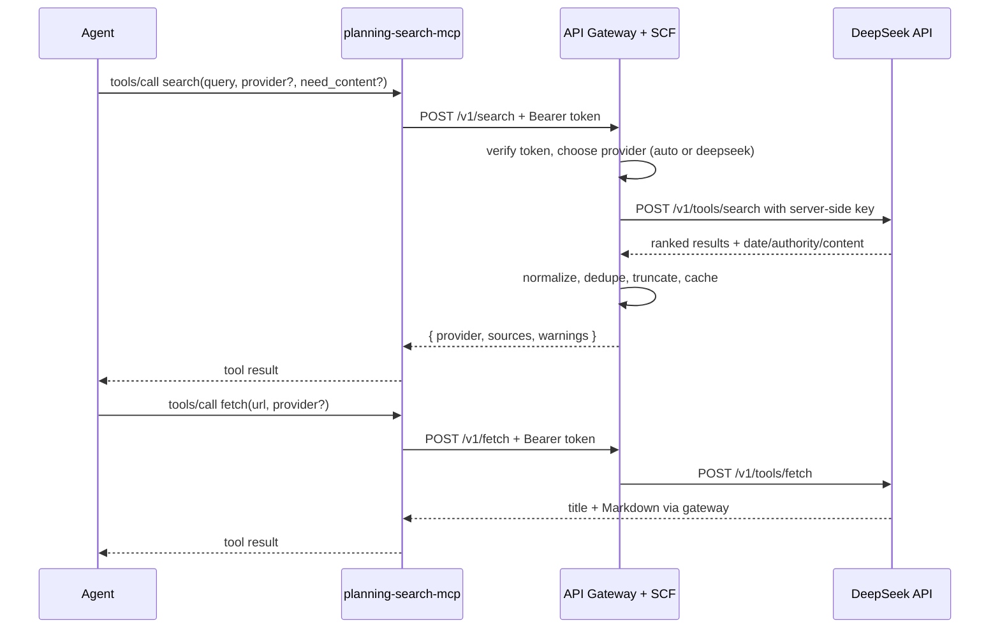
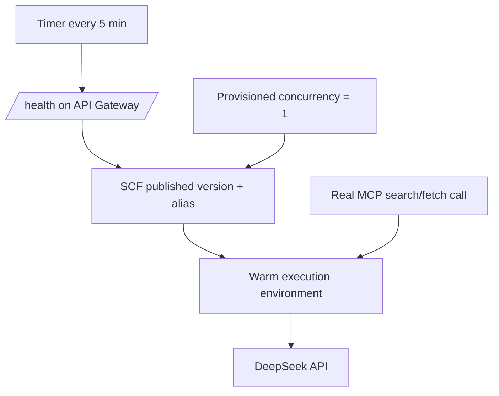

# Solution: Remote search gateway behind the search MCP

**Status:** Proposed · v2 accepted 2026-11-24 · first release targets Tencent Cloud SCF with DeepSeek only; Token Plan native search confirmed for the next provider
**Related:** `doc/RESEARCH_WORKFLOW_STRATEGY.md`, `doc/AUTOMATION_PLAN.md`, `AGENTS.md`

## Background

The app replaced ego(lite) as the default Research `Collect` runtime with a local stdio MCP (`planning-search-mcp`) that called a search provider directly. That coupled the client to the provider: the DeepSeek key lived in app Settings, adding a backend meant new adapters and new Settings fields, and provider metadata had no neutral home.

The v2 direction moves provider adapters and provider credentials into a **remote HTTP search gateway**. The client owns only a gateway URL and a gateway token. Search backends can be added or reordered on the server without touching the app or agent prompts.

Deployment constraints from the operator:

- A Tencent Cloud SCF environment already exists and is the intended first target.
- Call volume is low, so an idle SCF instance may be reclaimed and the next call pays a cold-start penalty. Warm-up is therefore part of the design, not an afterthought.
- The first release connects only to DeepSeek's native Search & Fetch APIs.
- Future provider sources are DeepSeek official, Tencent TokenHub Token Plan, and OpenCode Go subscriptions.

### Terminology and capability boundary

- **Native search backend**: an HTTP API that directly returns ranked sources and page content. DeepSeek Search & Fetch is the only one in scope for the first release.
- **Tencent Token Plan / TokenHub native search**: verified 2026-11-18. TokenHub supports server-side web search on its Anthropic Messages endpoint `/v1/messages` with the tool type `web_search_20250305`, and equivalent tools on Chat (`web_search_options.enable`) and Responses (`tools: [{type:"web_search"}]`). Messages returns `server_tool_use`, `web_search_tool_result` (with `url`, `title`, `snippet`, `page_age`) and a `text` answer. Supported models for Messages web search include `deepseek-v4-pro`, `deepseek-v4-pro-0813`, `deepseek-v4.1-flash` and `deepseek-v4.1-flash-1017`; Hy4/Hy3 use Chat/Responses only. Authentication is `x-api-key` plus `anthropic-version: 2023-06-01`. This makes Token Plan a genuine `search` backend, not merely a model subscription.
- **OpenCode Go**: an OpenAI-compatible model subscription with a curated model catalog. No native search endpoint has been verified, so it stays a `model`/`synthesis` provider until proven otherwise.
- **Agent runtime**: OpenCode, Codex, Claude Code consume tools; they are not gateway backends. An agent's own web search stays a prompt-level capability and is not listed as a provider.

The `provider` response carries `capabilities` per entry: `deepseek` → `["search", "fetch"]`, `tencent-tokenplan` → `["search"]`, `opencode-go` → `["model", "synthesis"]`. The `fetch` capability is deliberately not claimed for Token Plan because its Messages search returns snippets, not fetched page Markdown.

## Goals / Non-goals

**Goals**

- Add a search backend by changing only gateway code and configuration, never app Settings or agent configuration.
- Keep the MCP tool surface at two tools (`search`, `fetch`) with a stable schema; provider choice is an optional argument.
- Keep one canonical result shape so evidence writing is unchanged.
- Replace provider keys in the client with one gateway token owned by MCP service configuration.
- Deploy on Tencent Cloud SCF with a concrete warm-up strategy that avoids noticeable cold-start latency at low call volume.

**Non-goals**

- Treating agent runtimes as provider backends.
- Implementing Token Plan or OpenCode Go adapters in the first release.
- Changing the opt-in ego(lite) browser capability; it remains an advanced capability for signed-in and interactive pages.
- Multi-tenant billing, per-user quotas or a public developer portal in the first version.

## Design

```mermaid
flowchart LR
    A[OpenCode / Codex CLI] -->|stdio MCP| M[planning-search-mcp]
    M -->|HTTPS + Bearer token| GW[API Gateway]
    GW --> SCF[Search gateway on Tencent SCF]
    SCF --> D[DeepSeek Search & Fetch]
    SCF -.v1.1.-> T[TokenHub /v1/messages web_search_20250305]
    SCF -.fetch always routes here.-> D
    SCF -.future.-> OG[OpenCode Go model APIs]
    S[App Settings: gateway URL + token] -.->|credentials file| M
    K[SCF secrets: provider keys] -.-> SCF
    TIMER[Timer trigger every 5 min] -->|/health warm-up| GW
    SCF -->|canonical sources JSON| M
    M -->|tool result| A
    A --> E[Markdown evidence record]
```



### Components

- `crates/search-core` — keeps `SearchResult`, `FetchedPage`, `ProviderResponse`, `SearchError`, normalization and truncation. The `Provider` trait is replaced by a `GatewayClient` that speaks the HTTP API; canonical types stay identical.
- `crates/search-mcp` — unchanged two-tool stdio MCP. Reads `gateway_url` and `token` from the credentials file, adds the Bearer header, maps gateway errors to MCP tool errors, and keeps `--status` as a CLI probe.
- Search gateway — an SCF function behind API Gateway with a provider registry, server-side secrets, a small result cache, per-token provider allowlist and rate limits.
- Desktop app — Settings shows only the gateway URL and token. It may display the provider list returned by `/v1/provider`, but has no provider-specific fields.

### TokenHub Messages search adapter

The `tencent-tokenplan` adapter calls `POST /v1/messages` with `x-api-key` and `anthropic-version: 2023-06-01`, and declares:

```jsonc
{ "model": "deepseek-v4-pro", "max_tokens": 4096,
  "messages": [{ "role": "user", "content": "<research query>" }],
  "tools": [{ "type": "web_search_20250305", "name": "web_search" }] }
```

Mapping to the canonical result:

- `web_search_tool_result.content[]` → `sources[]`: `url` → `url`, `title` → `title`, `snippet` → `content`, `page_age` → best-effort `published_at` after normalizing its `YYYY/MM/DD HH:MM:SS` local form.
- `text` blocks are the model's answer and are **discarded** by the `search` tool. The gateway returns raw sources so the research agent, not the search provider, writes the evidence record.
- `usage.server_tool_use.web_search_requests` is recorded in gateway metrics for cost control.

Three constraints shape this adapter:

1. **The model decides whether to search.** TokenHub documents that the model autonomously judges whether a search is needed; empty results or a no-search decision produce no `web_search_tool_result`. The adapter must detect a missing result block and either retry with an explicit instruction to use the search tool, or return `no_results` so the gateway can fail over to `deepseek`.
2. **Snippets are not verified evidence.** The existing Collect policy explicitly rejects a search snippet as verified evidence. After a TokenHub search, the gateway must call a fetch-capable backend (`deepseek` in the first release) for the selected original URLs before returning full `content`. This keeps the canonical shape honest: `search` may come from Token Plan, but `fetch` always routes to a provider that returns page Markdown.
3. **Region and quota limits.** TokenHub web search is limited to the Guangzhou region at 5 QPS for the self-built service, and DeepSeek 原厂 Search/Fetch is billed separately with different rates for Token Plan points. The gateway enforces its own timeout, serialized calls and per-token quota; pricing must be rechecked before enabling this provider.

### Tool contract

The MCP tool list stays at exactly two tools; `status` is a CLI probe, not a tool.

- `search` — `query` (required, 1–128 characters), optional `count`, `need_content`, `ori_question`, `provider` (`auto` by default).
- `fetch` — `url` (required), optional `provider`.

`provider` is also an HTTP method on the gateway but is deliberately **not** an MCP tool: the agent rarely needs it and every extra tool costs context. The app can call `/v1/provider` for display. Site and date filters stay inside the query string using `site:`, `after:`, `before:` operators.

### Canonical result

Every backend maps into one shape, unchanged from v1:

```jsonc
{
  "provider": "deepseek",
  "sources": [{
    "url": "https://example.com/article",
    "title": "Article",
    "content": "Markdown body, server-truncated",
    "published_at": "2026-11-20T00:00:00Z",
    "authority": 3,
    "score": 0.8,
    "site_name": "Example"
  }],
  "warnings": []
}
```

`published_at` is UTC RFC 3339 or `null`, `authority` is `-1..4`, `score` is normalized to `0..1`. Responses are deduplicated by URL and capped at 60 KB; warnings record `response_truncated` or `content_truncated`.

### Provider selection

`provider: "auto"` uses the gateway's configured order. The first release has one provider (`deepseek`), so `auto` and `deepseek` are equivalent; once `tencent-tokenplan` is enabled it becomes a second `search` candidate with `deepseek` as the `fetch` backend for verified page content. `provider` on `/v1/fetch` selects a fetch-capable backend, not the search provider. OpenCode Go stays out of `auto` because its adapter has no verified search capability. A gateway token can be restricted to a subset of provider ids.

### Context budget

`additionalProperties: false`, short descriptions, default `count` of 8 capped at 10, 16 KB per source, 60 KB per response, and `need_content: false` as a lightweight links-only mode. Policy text stays in MCP initialization instructions rather than a `guide` tool.

### Invariant: provider differences stop at the gateway

All provider-specific complexity is consumed inside the gateway. The MCP client and the agent never see it:

- **One tool shape.** `search` and `fetch` keep the same schema for every backend. No provider-specific parameters, headers, tool names or model ids leak into the MCP tools.
- **One response shape.** Vendor-specific fields (`search_results`, `annotations`, `web_search_tool_result`, DeepSeek `rerank_score`/`authority`) are normalized into the canonical `sources[]` / `page` envelope before the response leaves the gateway.
- **Optional provider, `auto` by default.** The agent does not need to know which backend is healthy, cheap or capable. `auto` ordering, failover, per-token allowlists and quotas are gateway concerns.
- **Composition is internal.** If a provider can search but cannot fetch a full page, the gateway calls a fetch-capable backend itself and still returns one canonical result. The caller never performs a two-step provider dance.
- **Settings stay provider-agnostic.** The app stores only a gateway URL and token. `/v1/provider` is informational metadata for display; adding a backend never adds a Settings field or an i18n entry.
- **New backend = gateway change only.** A new adapter, secret and `auto` entry are deployed on SCF. No app rebuild, agent config change or prompt change is required.

## Interface contract

### HTTP gateway

All endpoints except `/health` require `Authorization: Bearer <token>` and answer JSON.

| Method | Path | Body | Response |
| --- | --- | --- | --- |
| `POST` | `/v1/provider` | `{}` or `{"id":"deepseek"}` | `{ "providers": [ { "id", "name", "capabilities": ["search","fetch"], "models": [], "default_model": null } ], "default": "deepseek" }` |
| `POST` | `/v1/search` | `{ "provider"?, "query", "count"?, "need_content"?, "ori_question"? }` | `{ "provider", "sources": [...], "warnings": [] }` |
| `POST` | `/v1/fetch` | `{ "provider"?, "url" }` | `{ "provider", "page": { "url", "title", "content" }, "warnings": [] }` |
| `GET` | `/health` | — | `{ "ok": true, "providers": ["deepseek"] }` |

Error mapping: `401/403` → `auth`, `429` → `rate_limit`, `400` → `invalid_params`, `5xx` or network failure → `transport`, empty results → `no_results`, fetch with no content → `fetch_failed`. API Gateway synchronous invocation does not retry errors, so the MCP maps these into its existing tool-error codes and the agent applies its own bounded retry.

### Client configuration

The credentials file outside the workspace changes from a provider key to gateway settings:

```jsonc
// ~/.config/planning-search/credentials.json (0600)
{ "gateway_url": "https://<api-gateway-host>/", "token": "gateway-token" }
```

Environment overrides keep server deployments UI-free: `SEARCH_GATEWAY_URL` and `SEARCH_GATEWAY_TOKEN` take precedence. Provider settings in the gateway use provider-agnostic names (`PROVIDER_CONFIG`, or `PROVIDER_<ID>_API_KEY` / `PROVIDER_<ID>_BASE_URL`, for example `PROVIDER_DEEPSEEK_API_KEY`). They exist only as SCF secrets and never appear in the app, the MCP process or run logs.

## Deployment and configuration

### Tencent Cloud SCF + API Gateway (chosen)

- API Gateway exposes `/v1/search`, `/v1/fetch`, `/v1/provider` and `/health` over HTTPS and performs request throttling.
- SCF holds one function with a published version and alias. Provider keys are stored as function environment secrets or in SSM; no key is embedded in code or client configuration.
- Synchronous API Gateway invocation is used for MCP calls; timeouts are set above the upstream DeepSeek timeout and the gateway enforces its own shorter deadline per call.

### SCF warm-up strategy

Two layers are combined because call volume is low and cold starts are user-visible:

1. **Provisioned concurrency (primary).** Configure one provisioned instance on a **published version / alias**, not on `$LATEST`, because SCF only allows provisioned concurrency on released versions. The platform starts the instance in advance and does not proactively reclaim it. Publish a new version and move the alias whenever gateway code changes.
2. **Timer-trigger warm-up (secondary).** A timer trigger invokes `/health` every 5 minutes with a minimal body. It keeps the execution environment alive between real calls and provides a fallback if provisioned concurrency is unavailable or too costly. The warm-up must not call any provider API, so it costs no provider quota.
3. **Light initialization.** Keep module-level initialization small: parse config, create an HTTP client, register providers. Defer cache connection setup until the first real search if it is expensive.
4. **Observability.** Track the `Coldstart` duration in SCF logs, provisioned-concurrency utilization, and API Gateway p95 latency. If cold starts remain visible, raise provisioned concurrency or shorten the warm-up interval.



### Alternatives kept in reserve

Cloudflare Workers remains viable if DeepSeek egress and cost targets change; a same-server container remains the fallback if SCF warm-up proves too expensive. Neither changes the gateway API, so switching platforms does not affect the client.

### Agent wiring

Codex and OpenCode registration is unchanged: both start the same `planning-search-mcp` binary. Only the credentials file contents change, so no agent config or prompt edit is needed. `--status` probes `/health` and an empty `/v1/provider` call rather than a billed search.

## Rollout plan

1. **v1 done (2026-11-24).** Local MCP with a direct DeepSeek adapter, canonical contract, app wiring, search-first prompts, opt-in ego(lite) capability.
2. **Gateway service (next).** Implement the three HTTP endpoints on SCF behind API Gateway, DeepSeek native adapter, token auth, secrets, small cache and quotas. Configure provisioned concurrency on a published alias plus a 5-minute timer warm-up.
3. **MCP slim client.** Replace direct provider adapters in `search-core` with the HTTP gateway client; keep the two-tool contract; update `--status` to probe the gateway.
4. **Settings migration.** Replace the DeepSeek API key field with gateway URL and token, update i18n entries, keep environment overrides for servers.
5. **Verification.** Isolated QA against a fake gateway, then one real DeepSeek research run. Compare evidence fields against the v1 baseline. Measure cold-start and warm p95 latency before and after warm-up is enabled.
6. **Provider expansion (later, no app changes).** Add `tencent-tokenplan` as a `search` backend using the Anthropic Messages `web_search_20250305` adapter, with DeepSeek fetch for verified page content. OpenCode Go remains `model`/`synthesis` until a native search capability is verified. No app or agent configuration changes are needed for either step.

## Risks and boundaries

- SCF cold starts add latency. Provisioned concurrency plus timer warm-up mitigates this; measure cold-start logs rather than assuming the warm-up works.
- API Gateway synchronous calls do not retry. The MCP must map errors to stable tool codes and let the agent apply bounded retries.
- Provider keys live in SCF secrets. A leaked gateway token is scoped to search and can be restricted to provider ids, rotated independently of provider keys.
- TokenHub native search is model-autonomous: a missing `web_search_tool_result` means no search happened, not that the query had no results. The adapter detects this and fails over instead of returning a confident empty answer.
- TokenHub Messages search returns snippets, not fetched page Markdown. Without the mandatory DeepSeek fetch step the evidence policy would be violated, so `tencent-tokenplan` is `search`-only and `fetch` is routed separately.
- TokenHub Messages uses `x-api-key` and `anthropic-version` headers, not the Bearer header used elsewhere; `web_search_20250305` is not interchangeable with the Responses `web_search` tool. Model and protocol support must be pinned per adapter.
- Search pricing and quotas change (self-built lite/standard versions, separate DeepSeek 原厂 Search/Fetch billing, Token Plan points, 5 QPS and Guangzhou-only). Recheck the current price sheet before enabling the provider and keep per-token quotas enforced.
- OpenCode Go remains `model`/`synthesis` until a native search capability is verified; registering it as `search` without an adapter would overpromise.
- Subscription quotas have windows (for example Token Plan monthly reset and OpenCode Go five-hour limits). The gateway must surface `rate_limit` cleanly rather than failing mid-research.
- Research queries pass through the gateway operator's infrastructure; document this data path for sensitive topics.
- Provider calls are billed. Per-token quotas, result caching and the existing `count`/content caps are required from day one.
- ego(lite) remains an opt-in advanced capability (`ResearchConfig.ego_lite_enabled`, default off) for signed-in, verification or interactive pages; unchanged by this design.

## Update log

- 2026-11-24 — Initial solution: local stdio MCP with a direct DeepSeek adapter, canonical result shape, app wiring, search-first Collect prompts, opt-in ego(lite) capability and documentation conventions.
- 2026-11-24 — App wiring and prompt migration: persisted `search_mcp_path`, Codex MCP registration, OpenCode env passthrough, and a matching update to `doc/RESEARCH_WORKFLOW_STRATEGY.md`.
- 2026-11-24 — Startup setup switched from ego(lite) to the search runtime; third card and i18n entries retitled; `DESIGN.md` kept consistent.
- 2026-11-24 — API key moved to a 0600 credentials file outside the workspace and injected into agent subprocesses, with environment variables taking precedence.
- 2026-11-24 — ego(lite) became an opt-in advanced capability (`ego_lite_enabled`, default off), not a fallback.
- 2026-11-24 — v2 direction accepted: a remote HTTP search gateway with `search`, `fetch` and `provider` methods; provider keys move to server secrets; the client keeps only a gateway URL and token.
- 2026-11-24 — First release narrowed to Tencent Cloud SCF + API Gateway with DeepSeek only. Added the SCF warm-up design (provisioned concurrency on a published alias plus a five-minute timer `/health` trigger) and documented API Gateway synchronous error semantics. Token Plan was initially classified as a model-only subscription; the following entry corrects that after verifying the native search API.
- 2026-11-24 — Verified TokenHub native web search on Anthropic Messages (`web_search_20250305`) and corrected the provider taxonomy: `tencent-tokenplan` is a genuine `search` backend for the next release, `opencode-go` stays `model`/`synthesis`. Documented the Messages adapter, model-autonomous search caveat, snippet-only results with mandatory DeepSeek fetch, and `x-api-key` / `anthropic-version` protocol differences.
- 2026-11-24 — Made "provider differences stop at the gateway" an explicit design invariant: fixed MCP tool/response shapes, `auto` provider selection, internal composition of search + fetch, provider-agnostic Settings, and new backends requiring gateway-only changes.
- 2026-11-24 — Gateway configuration became provider-agnostic: `DEEPSEEK_API_KEY` / `DEEPSEEK_BASE_URL` were replaced by `PROVIDER_CONFIG` or `PROVIDER_<ID>_API_KEY` / `PROVIDER_<ID>_BASE_URL`, with `PROVIDER_ORDER` as the auto-order variable.
